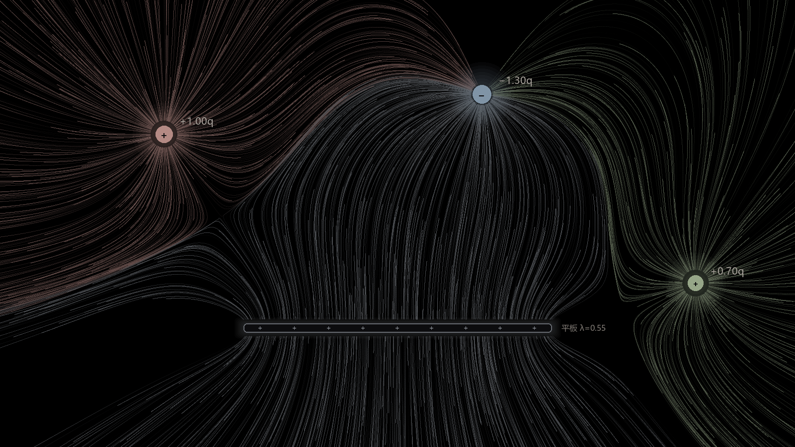

# 电磁场可视化 · Electric Field Visualization

用 p5.js 做的实时电场流场动画：**若干有限长均匀带电平板** + **若干可拖动的点电荷**，
粒子沿电场方向运动，在拖尾层上留下连续的场线。

右侧带有实时编辑面板，可以改电荷量、平板长度与线电荷密度、配色，并随时增删电荷和平板。
默认配色为**莫兰迪色系**，背景纯黑。



## 快速开始

```bash
git clone <你的仓库地址>
cd Electromagnetic-Field-Visualization
```

然后**双击 `index.html`**。不需要安装、不需要构建、不需要本地服务器。

> 唯一要求是能访问 CDN（页面从 jsdelivr 加载 p5@2.3.4）。离线使用时把
> `lib/p5.min.js` 下载到本地、改一下 `<script src>` 即可。

## 操作

| 位置 | 操作 | 效果 |
|---|---|---|
| 画面 | 拖动电荷 | 实时改变整个电场 |
| 画面 | 拖动平板 | 同上（平板整体平移，不旋转） |
| 画面 | 悬停 | 出现抓取环 / 高亮框，光标变 `grab` |
| 面板 · 流场 | 粒子数 / 拖尾长度 / 流速 | 控制场的密度与流动感 |
| 面板 · 电荷 | q 滑杆或数字框 | 电荷量 −3 ~ +3，实时生效 |
| 面板 · 电荷 | 色块 / `×` | 改颜色 / 删除 |
| 面板 · 平板 | 长度 / λ / 色块 / `×` | 改几何、强度、颜色，删除（均可直接输入数值） |
| 面板 | `+ 添加电荷` / `+ 添加平板` | 上限 8 个电荷、6 块平板 |
| 面板 | 重置为默认 | 位置、参数、配色全部还原 |
| 键盘 | `R` | 同上 |

电荷量为正时向外发射场线，为负时吸收，为 0 时不参与计算。
平板 λ 同理可为负（相当于带负电的板，场线终止于它）；λ 为 0 时不参与计算但仍可拖动。

### 值得试的几个构型

| 拖法 | 会看到 |
|---|---|
| **加一块平板，拖到第一块正上方，λ 一正一负** | **平行板电容器**：中间出现均匀的平行场线 |
| 负电荷拖到平板正上方 | 场线从扇形散开收拢成**垂直平行束**（匀强场） |
| 两块平板并排 | 中间出现**中和区**，两侧场线向外排斥 |
| 两个正电荷靠近 | 中间出现**暗区**（场强零点），两侧场线被挤开绕行 |
| 正电荷拖到负电荷旁 | 放射状变成**偶极子**的纺锤形 |
| 把某块平板的 λ 拖到 0 | 那块平板只剩轮廓，不再影响场 |
| 删掉所有源 | 场完全消失（粒子停止绘制） |

## 物理模型

**点电荷**

```
E = k·q·(r − r₀) / |r − r₀|³
```

**有限长均匀线电荷**（平板，侧视图，解析解而非数值积分）

```
Ex = kλ·(1/ra − 1/rb)
Ey = kλ·(b/rb − a/ra) / y

a = x − L/2      b = x + L/2
ra = √(a² + y²)  rb = √(b² + y²)
```

平板被当作一条均匀线电荷处理——这是「薄板侧视」的标准近似。

## 实现要点

**1. 两块画布**

拖尾需要「不清空画布、只让它变淡」。但如果平板、电荷、文字也画在同一块画布上，
它们会每帧叠加一次，几十帧后糊成实心色块。所以拆成两层：

```js
// ① 拖尾层：不清空，只按 alpha 衰减
trail.background(BG[0], BG[1], BG[2], TRAIL_ALPHA);
trail.push();
trail.translate(W / 2, H / 2);      // ← 和静态层用同一个原点
trail.line(s.x0, s.y0, s.x1, s.y1);
trail.pop();

// ② 主画布：每帧彻底重画
background(BG[0], BG[1], BG[2]);
image(trail, 0, 0);
drawPlate(); drawCharges(); drawLabels();
```

**2. 只取场方向，不取场强**

粒子速度恒定，否则靠近平板时会被 `1/y` 奇异性甩飞出画面。场线密度本身已经
表达了场强大小。

**3. 源头加权抽样**

粒子不按画布均匀撒，而是按「正电荷 |q|」和「平板 λ」加权，从源表面发射。
场线的密度因此天然反映了每个源的强弱。

**4. 固定微小偏角**

每个粒子带一个 ±0.03 rad 的固定偏角。不加的话，两个正源之间会出现一条极度
锐利的分界线（电场零点处的分界线，separatrix），看起来像贴图接缝。

**5. 归一化长度尺度**

点电荷是 `1/r²`、线电荷是 `1/r` 量级，直接相加会让平板强出几百倍。所有坐标
先除以 `R0 = 100` 再计算，让两者可比。

**6. 莫兰迪配色**

低饱和 + 灰度底子，亮度压到 60% 左右——再亮就会在纯黑背景上糊成白色。
颜色只用来区分「场线来自哪个源」，不承载正负。

**7. 响应式画布与手机布局**

画布尺寸不是写死的。启动和窗口变化时，按 `#stage` 的实际可用区域**直接创建对应像素数的画布**，
不做 CSS 缩放（高分屏用 `pixelDensity(min(devicePixelRatio, 2))` 保证清晰）。

**世界坐标就是画布像素**——没有「设计空间 → 画布」的缩放层，所以画布怎么变，内容都铺满，
不会出现上下或左右的黑边。场景坐标以比例形式保存：

```js
// 装载时：参考像素 → 比例
nx = x / refW;  ny = y / refH;  nlen = len / refW;

// 渲染前：比例 → 当前画布像素
x = nx * W;     y = ny * H;     len = nlen * W;
```

窗口尺寸变化时只需重跑一次 `syncLayout()`，布局自动按新尺寸重排；拖动结束后用
`captureLayout()` 把新位置写回比例。长度尺度 `R0 = W / 16` 也跟着宽度走，场的形态保持稳定。

**手机不是把宽屏缩小**——那样文字只有 5px，没法看。屏幕宽度 ≤ 760px 时切换成竖屏场景：

| | 宽屏 `wide` | 手机 `tall` |
|---|---|---|
| 参考尺寸 | 1600 × 900 | 440 × 640 |
| 布局 | 左侧画布 + 右侧面板 | 上方画布 + 下方面板 |
| 默认摆位 | 电荷横向铺开 | 电荷竖向堆叠，平板压在下部 |

两套场景各自有一套默认坐标（`LAYOUTS`），切换布局时整场景重载。

其余要点：

- 指针坐标只需减去画布中心，没有额外变换，拖拽在任何尺寸下都准
- 窗口尺寸变化时拖尾层会重建，所以那一刻场线会清空、重新累积（约 0.5 秒）
- 背景与拖尾都收敛到**纯黑**（`BG = [0,0,0]`），空白区不会残留深灰

## 目录

```
.
├─ index.html            # 全部代码（单文件，无构建）
├─ docs/preview.png      # README 截图
└─ tools/
   ├─ sim.mjs            # 离线：驱动粒子系统 → density.bin + scene.json
   └─ preview_flow.py    # 离线：密度图 → docs/preview.png
```

`tools/` 只用于生成 README 的静态图，**和页面运行完全无关**。它从 `index.html`
里抽出 `<script>` 直接执行，保证预览用的数学和页面是同一份代码；配色和几何从
`scene.json` 读取，所以改完参数重跑一次，截图会自动同步。

```bash
node tools/sim.mjs           # → tools/density.bin, tools/scene.json
python tools/preview_flow.py # → docs/preview.png
```

依赖：Node 18+、Python 3.9+（numpy、Pillow）。

## 已知限制

- 需要联网（从 CDN 载入 p5）
- 平板只能整体平移，**不能旋转**
- **尚未实现视频导出**：拖拽会破坏帧的确定性，导出时需先把构型写死
- 场强只用颜色和密度表达，没有等势线

## 参数

集中在 `index.html` 顶部：

```js
const MORANDI = [...]         // 莫兰迪色板，新增电荷/平板时按顺序取
const DEFAULT_CHARGES = [...] // 默认三个电荷（可被面板修改）
const DEFAULT_PLATES  = [...] // 默认一块平板
const MAX_CHARGES = 8
const MAX_PLATES  = 6
```

运行时参数（粒子数、拖尾长度、流速）由面板控制，不写死在源码里。

## 版本

当前 **v0.0.4**，显示在页面左下角（手机端移到右上角）。版本号只写在 `index.html` 的 `<div id="ver">` 里，
改一处即可。

| 段位 | 含义 |
|---|---|
| `0.0.x` | 开发中，参数和交互随时会变 |
| `0.x.0` | 有一组可用的稳定功能 |
| `1.0.0` | 认为可以直接交付给别人用 |

## 许可

MIT（如果你要加 LICENSE 文件的话）。底层依赖 [p5.js](https://p5js.org/)，LGPL-2.1。
