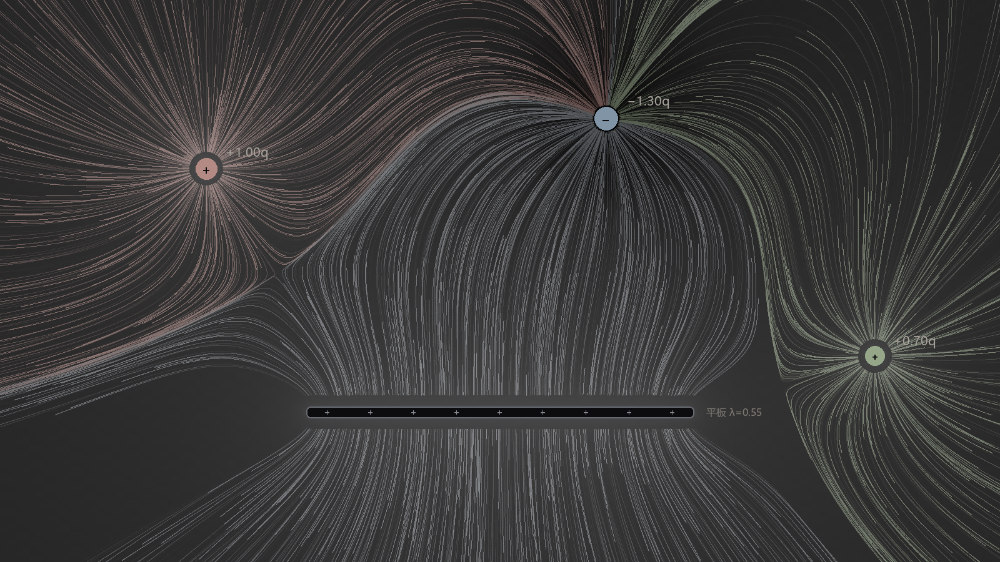

# 电磁场可视化 · Electric Field Visualization

用 p5.js 做的实时电场流场动画：**若干有限长均匀带电平板** + **若干可拖动的点电荷**，
粒子沿电场方向运动，拖动出连续的场线；也可以切换成「真实粒子轨迹」，看惯性如何让带电粒子偏离场线。

右侧带有实时编辑面板，可以改电荷量、平板长度与线电荷密度、配色，并随时增删电荷和平板。
默认配色为**莫兰迪色系**，背景纯黑。



## 快速开始

```bash
git clone <你的仓库地址>
cd Electromagnetic-Field-Visualization
```

然后**双击 `index.html`**。不需要安装、不需要构建、不需要本地服务器。

> 唯一要求是能访问 CDN（页面从 jsdelivr 加载 p5@2.3.4）。离线使用时把
> `lib/p5.min.js` 下载到本地、改一下 `<script src>` 即可。

## 操作

| 位置 | 操作 | 效果 |
|---|---|---|
| 画面 | 拖动电荷 | 实时改变整个电场 |
| 画面 | 拖动平板 | 同上（平板整体平移，不旋转） |
| 画面 | 悬停 | 出现抓取环 / 高亮框，光标变 `grab` |
| 面板 · 显示方式 | `场线` / `粒子轨迹` | 切换两种物理模型，见下节 |
| 面板 · 流场 | 粒子数 / 拖尾长度 / 流速 | 控制场的密度与流动感 |
| 面板 · 电荷 | q 滑杆或数字框 | 电荷量 −3 ~ +3，实时生效 |
| 面板 · 电荷 | 色块 / `×` | 改颜色 / 删除 |
| 面板 · 平板 | 长度 / λ / 色块 / `×` | 改几何、强度、颜色，删除（均可直接输入数值） |
| 面板 | `+ 添加电荷` / `+ 添加平板` | 上限 8 个电荷、6 块平板 |
| 面板 | `清空所有粒子` | 粒子数归零，画面一并擦净 |
| 面板 | 重置为默认 | 位置、参数、配色全部还原 |
| 键盘 | `R` | 同上 |

电荷量为正时向外发射场线，为负时吸收，为 0 时不参与计算。
平板 λ 同理可为负（相当于带负电的板，场线终止于它）；λ 为 0 时不参与计算但仍可拖动。

### 两种显示方式

| | 场线 `field` | 粒子轨迹 `trajectory` |
|---|---|---|
| 粒子 | 无质量的示踪点 | 有质量、带电荷的粒子 |
| 运动 | 每帧沿 **E 的方向**移动固定距离 | 按 **a = qE/m** 积分速度和位置 |
| 轨迹形状 | 就是场线本身（流线） | **不贴着场线**——惯性让它冲出弧线、被偏折 |
| 渲染 | 累积层逐帧衰减，形成长尾 | 每帧重画，按粒子自己的路径点连折线 |
| 滑杆「拖尾/轨迹长度」 | 累积层衰减速度 | 保留多少帧路径 |
| 出射方向 | — | 沿**法线**（局部 E 方向），±16° 抖动 |
| 出射速度 | — | 面板「出射速度」滑杆，0.3 ~ 8 |
| 粒子数范围 | 200 ~ 2600 | **0 ~ 400** |
| 默认粒子数 | 1400（小屏 700） | **40（小屏 20）** |
| 速度表现 | 恒定（只沿方向） | **逐段着色**：每段用绘制那一刻的速度决定亮度与粗细 |
| 寿命 | 撞到电荷或飞出画布 | **无寿命限制**，只在飞出或被吸收时重生 |
| 撞到极板 | 不受影响 | **被吸收**（正负极板都挡，半径 10px） |

粒子沿法线射出，但因为**带着质量**，它不会跟着场线一起转弯——在曲率大的地方
（电荷附近、平板边缘）会明显冲出弧线，甚至被负电荷「甩」出去（类似卢瑟福散射）。
把出射速度调大，轨迹会更长、更接近直线；调小则行程短、弯曲明显。这是真正的物理效果：同样的场，慢粒子有更多时间被横向拽偏（偏转角 ∝ 1/v²）。

轨迹模式的粒子数上限压到 400——每条路径上百个点，粒子一多就糊成一片。
**极板是实体电极**：不论 λ 正负，进入 10px 吸收带（板半高 9px，只多留 1px）就被吸收并重生，
所以不会从看起来实心的板子里穿过去。粒子出生点在板面外 24px，不会一出生就被吃掉。
负电荷的吸收半径是 5px——要贴得很近才会被吞，粒子可以几乎擦着电荷飞过去；
正电荷只偏折、不吸收，因为要看的是散射。

**自无穷远的流入**：约 25% 的粒子不再从源表面发射，而是从画布边框外 30px 处投放，
并挑「场最朝里指」的那个候选点，所以它们是一路流进画面的。场线模式里这就是
原本缺失的『来自无穷远的场线』——只有终点在画面内的汇（负电荷）才能看到它们收进来。

### 值得试的几个构型

| 拖法 | 会看到 |
|---|---|
| **加一块平板，拖到第一块正上方，λ 一正一负** | **平行板电容器**：中间出现均匀的平行场线 |
| 负电荷拖到平板正上方 | 场线从扇形散开收拢成**垂直平行束**（匀强场） |
| 两块平板并排 | 中间出现**中和区**，两侧场线向外排斥 |
| 两个正电荷靠近 | 中间出现**暗区**（场强零点），两侧场线被挤开绕行 |
| 正电荷拖到负电荷旁 | 放射状变成**偶极子**的纺锤形 |
| 把某块平板的 λ 拖到 0 | 那块平板只剩轮廓，不再影响场 |
| 删掉所有源 | 场完全消失（粒子停止绘制） |

## 物理模型

**点电荷**

```
E = k·q·(r − r₀) / |r − r₀|³
```

**有限长均匀线电荷**（平板，侧视图，解析解而非数值积分）

```
Ex = kλ·(1/ra − 1/rb)
Ey = kλ·(b/rb − a/ra) / y

a = x − L/2      b = x + L/2
ra = √(a² + y²)  rb = √(b² + y²)
```

平板被当作一条均匀线电荷处理——这是「薄板侧视」的标准近似。

## 实现要点

**1. 拖尾：浏览器衰减 + 分带清零残留**

拖尾用「不清空画布、每帧盖一层半透明黑」来做，衰减完全交给浏览器——全分辨率，
线条清晰不糊。但这有个 8 位量化的死结：

```
新值 = 旧值 × (1 − alpha/255)   // 结果要四舍五入到整数
```

`round(v × 0.968) = v` 在 `v ≤ 15` 时恒成立，**暗部像素永远衰减不下去**，背景停在深灰。

解法是每帧额外把「低于阈值」的像素直接置 0。为了不让遍历拖慢帧率，画面被切成
**10 条横带轮转扫描**——每帧只读 1/10 的画面，每个像素约 10 帧被清一次：

```js
const bandH = Math.ceil(ch / RESIDUE_BANDS);
const img = ctx.getImageData(0, y0, cw, bandH);

for (let i = 0; i < img.data.length; i += 4) {
  if (img.data[i] < T && img.data[i+1] < T && img.data[i+2] < T) {
    img.data[i] = img.data[i+1] = img.data[i+2] = 0;
  }
}
ctx.putImageData(img, 0, y0);
```

阈值 `T` 跟着衰减系数走——它必须略高于「卡死点」`0.5 / (alpha/255)`，否则清不干净：

```js
const T = min(48, max(12, ceil(127.5 / TRAIL_ALPHA) + 6));
```

结果：衰减仍然平滑（浏览器混合），但暗部会在约 1/6 秒内被彻底抹平，空白区回到 `#000`。

**2. 只取场方向，不取场强**

粒子速度恒定，否则靠近平板时会被 `1/y` 奇异性甩飞出画面。场线密度本身已经
表达了场强大小。

**3. 源头加权抽样**

粒子不按画布均匀撒，而是按「正电荷 |q|」和「平板 λ」加权，从源表面发射。
场线的密度因此天然反映了每个源的强弱。

**4. 固定微小偏角**

每个粒子带一个 ±0.03 rad 的固定偏角。不加的话，两个正源之间会出现一条极度
锐利的分界线（电场零点处的分界线，separatrix），看起来像贴图接缝。

**5. 归一化长度尺度**

点电荷是 `1/r²`、线电荷是 `1/r` 量级，直接相加会让平板强出几百倍。所有坐标
先除以 `R0 = 100` 再计算，让两者可比。

**6. 莫兰迪配色**

低饱和 + 灰度底子，亮度压到 60% 左右——再亮就会在纯黑背景上糊成白色。
颜色只用来区分「场线来自哪个源」，不承载正负。

**7. 响应式画布与手机布局**

画布尺寸不是写死的。启动和窗口变化时，按 `#stage` 的实际可用区域**直接创建对应像素数的画布**，
不做 CSS 缩放（高分屏用 `pixelDensity(min(devicePixelRatio, 2))` 保证清晰）。

**世界坐标就是画布像素**——没有「设计空间 → 画布」的缩放层，所以画布怎么变，内容都铺满，
不会出现上下或左右的黑边。场景坐标以比例形式保存：

```js
// 装载时：参考像素 → 比例
nx = x / refW;  ny = y / refH;  nlen = len / refW;

// 渲染前：比例 → 当前画布像素
x = nx * W;     y = ny * H;     len = nlen * W;
```

窗口尺寸变化时只需重跑一次 `syncLayout()`，布局自动按新尺寸重排；拖动结束后用
`captureLayout()` 把新位置写回比例。长度尺度 `R0 = W / 16` 也跟着宽度走，场的形态保持稳定。

**手机不是把宽屏缩小**——那样文字只有 5px，没法看。屏幕宽度 ≤ 760px 时切换成竖屏场景：

| | 宽屏 `wide` | 手机 `tall` |
|---|---|---|
| 参考尺寸 | 1600 × 900 | 440 × 640 |
| 布局 | 左侧画布 + 右侧面板 | 上方画布 + 下方面板 |
| 默认摆位 | 电荷横向铺开 | 电荷竖向堆叠，平板压在下部 |

两套场景各自有一套默认坐标（`LAYOUTS`），切换布局时整场景重载。

其余要点：

- 指针坐标只需减去画布中心，没有额外变换，拖拽在任何尺寸下都准
- 窗口尺寸变化时场景按比例重排，不重建任何缓冲
- 累积层由浏览器做 alpha 衰减，另配分带清零，空白区最终回到 `#000`

**8. 两种模式共用一套场，只换积分方式**

场强计算 `fieldAt()` 是同一个函数，差别只在「怎么用这个场」：

```js
// 场线：无质量，直接沿单位方向走固定步长
p.x += (E / |E|) * SPEED;

// 轨迹：有质量，先积加速度再积位置
v += qE / m * dt;
p.x += v;
```

所以轨迹模式必须额外存 `vx / vy`，并且给粒子一个**切向初速度**——否则粒子从静止
开始加速，轨迹会和场线完全重合，看不出区别。

物理上还有一个取舍：轨迹模式**不因撞到电荷而消失**。场线模式的粒子是一撞就没的
（它代表流线的终点），但真实粒子穿过电荷附近会被偏折，穿过去才是要看的东西。

路径点存在 `p.hist` 里（每帧推一对坐标，超过 `PATH_N` 就丢弃最旧的）。绘制时按
`粒子数 × PATH_N` 估算顶点量，超过约 6 万就按步长抽稀，避免长路径拖慢帧率。

**9. 电势底色**

背景亮度编码电势高低：

```
点电荷:      V = Σ kq / r
有限长线电荷: V = kλ · [asinh((x+L)/|y|) − asinh((x−L)/|y|)]
```

`asinh` 那项是 `∫ dx'/√((x−x')²+y²)` 的解析解，和场强用的公式同源。

四个工程细节：

- **双向映射**。「无穷远」不设成黑，而是落在 `POT_FLOOR`（默认 26）这个中间值上：
  正电势往上走到 `POT_MAX`，负电势往下走到 0。这样两个方向都有显示空间，
  负电荷周围才暗得下去。
- **对数映射**。电势在电荷处 1/r 发散、跨度几个数量级，线性映射会让除电荷附近以外
  全黑，近处又变化过陡。改用 `t = log(1+|V|/V₀) / log(1+V_max/V₀)`。
- **不截断**。归一化常数 `POT_VMAX` 取得比实际峰值大，`t` 恒小于 1，所以**没有饱和
  平台**——一旦截断，近处一整片顶在最大值，外面只能一格一格往下跳，放大后就是阶梯。
- **软截断 + 细网格**。近距离项用 `√(r²+ε²)` 而不是 `max(r, ε)`，并且 ε 取得比网格
  间距大，把 1/r 尖峰摊平；实测相邻格之间的亮度跳变不超过 4 级。

底色用加法混合：场线模式的累积层不透明，只能 `blendMode(ADD)` 叠在上面；
轨迹模式每帧清屏，直接正常绘制即可。

电势图算在 400×225 的网格上，带半色阶抖动，只在场景变化时重算（`potDirty`）。

可调参数：`POT_MAX`（正方向最亮，默认 100）、`POT_FLOOR`（无穷远亮度，默认 26）、
`POT_V0`（对数尺度，默认 0.6）、`POT_VMAX`（归一化上限，默认 20）。

> 注意：电势是**对数**衰减的，一块平板加几个电荷在整幅画面里本来就接近均匀，
> 所以底色看起来是淡淡的一层，而不是强烈的渐变。想要更强对比就调小 `POT_V0`。

## 目录

```
.
├─ index.html            # 全部代码（单文件，无构建）
├─ docs/preview.png      # README 截图
└─ tools/
   ├─ sim.mjs            # 离线：驱动粒子系统 → density.bin + scene.json
   └─ preview_flow.py    # 离线：密度图 → docs/preview.png
```

`tools/` 只用于生成 README 的静态图，**和页面运行完全无关**。它从 `index.html`
里抽出 `<script>` 直接执行，保证预览用的数学和页面是同一份代码；配色和几何从
`scene.json` 读取，所以改完参数重跑一次，截图会自动同步。

```bash
node tools/sim.mjs           # → tools/density.bin, tools/scene.json
python tools/preview_flow.py # → docs/preview.png
```

依赖：Node 18+、Python 3.9+（numpy、Pillow）。

## 已知限制

- 需要联网（从 CDN 载入 p5）
- 平板只能整体平移，**不能旋转**
- **尚未实现视频导出**：拖拽会破坏帧的确定性，导出时需先把构型写死
- 场强只用颜色和密度表达，没有等势线

## 参数

集中在 `index.html` 顶部：

```js
const MORANDI = [...]         // 莫兰迪色板，新增电荷/平板时按顺序取
const DEFAULT_CHARGES = [...] // 默认三个电荷（可被面板修改）
const DEFAULT_PLATES  = [...] // 默认一块平板
const MAX_CHARGES = 8
const MAX_PLATES  = 6
```

运行时参数（粒子数、拖尾长度、流速）由面板控制，不写死在源码里。`拖尾长度` 控制累积层的衰减速度：数值越大，线越长。

## 版本

当前 **v0.0.21**，显示在页面左下角（手机端移到右上角）。版本号只写在 `index.html` 的 `<div id="ver">` 里，
改一处即可。

| 段位 | 含义 |
|---|---|
| `0.0.x` | 开发中，参数和交互随时会变 |
| `0.x.0` | 有一组可用的稳定功能 |
| `1.0.0` | 认为可以直接交付给别人用 |

## 许可

MIT（如果你要加 LICENSE 文件的话）。底层依赖 [p5.js](https://p5js.org/)，LGPL-2.1。
